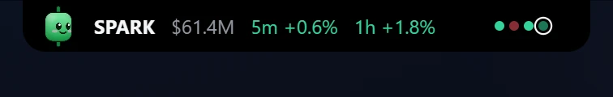
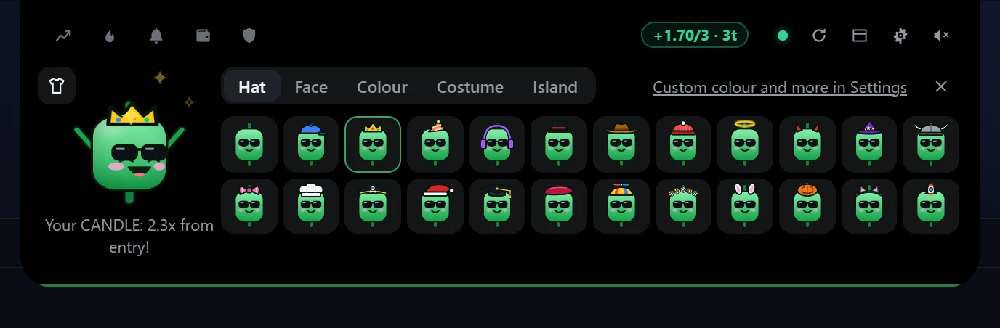
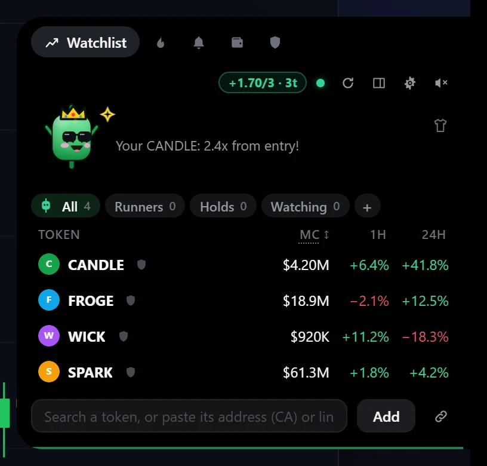

# Candy — Trader Companion

A tiny mascot that lives at the top of your screen, on Windows, Linux or
macOS, and keeps an eye on your memecoins on Solana, BSC, Ethereum and
Robinhood Chain. In ten languages.

### [Install Candy](#install) on Windows, Linux or macOS

Free and open source, and built on your own PC from this code: there is no
prebuilt download to trust.

<p align="center">
  
</p>
<p align="center">
  
  <br><sub>Folded, it is a one-line ticker at the top of your screen. Hover it to open.</sub>
</p>

- **Watchlist ticker** — market cap (the price, for major coins: click the
  column to switch), volume and buys / sells (5m, 1h, 6h or 24h, as GMGN
  shows them) and 5m / 1h / 24h change, always in view; click to
  open the full list, click a token to open it on GMGN, Axiom, Based Bot or
  DexScreener.
  Folders (Runners, Holds, Watching, your own) sort the list, each with a mini
  Candy in the colour of its hour. Each token's mini 24 h chart has its chain's
  coin (SOL, BNB, ETH) as a faint dashed line: did it rise alone or with the
  market? Folded, a dot per token shows how the whole list moved in the last
  hour, a dot on Candy flags an alert you haven't looked at yet, and the
  ticker calls out each buy and sell as it happens, yours and the wallets you
  follow. Click a column's head to sort by it (again to flip it, a third time
  for your own order), and pin a token with its ☆ to keep it on top.
- **Drag and drop** — drag a token's link (DexScreener, GMGN, Axiom, Based Bot, an
  explorer) or its address from your browser onto Candy: his eyes follow it,
  his mouth opens, a bar runs along the island while it is looked up, and he
  swallows it with a green check as the token joins your watchlist.
- **My wallet** — add your own Solana wallet (public address only): its SOL and
  value show at once, its recent trades are read from its last 50
  transactions (round trips that closed go into your journal), and from then
  on its buys and sells are recorded, with value, average entry (from its own
  transactions), profit and multiple per token. Each check reads its new
  transactions too, so a token bought and sold within the same minute still
  shows, at the price it really traded at. The tab opens on four cards (the
  wallet's value, open PnL, what today's sales took, the best multiple), a
  bar of each token's share of the wallet, and one row per token with its
  logo, how long it has been held, entry → now, value and share, profit, %
  and multiple, sortable, with a line under it showing the way to your target,
  stop or next multiple; Activity groups the buys and sells by day. Alerts
  at the levels you pick (2x, −30%…). Junk is left out: airdropped scams (a name that advertises a
  site) and coins worth more, at their quoted price, than all the real money
  in their pool — a wallet full of them looks rich and can sell none of it.
- **Solana, BSC, Ethereum and Robinhood Chain** — pick one, several or all for
  search, trending and the header prices (SOL, BNB, ETH), plus BTC and the
  crypto Fear & Greed index.
- **Search by name** — type "pump", pick from the results. Results rank by
  liquidity *backed by real money* (SOL / USDC / ETH / BNB in the pool), so
  fakes that report billions in liquidity of themselves sink, flagged ⚠.
- **Major coins too** — the 30 largest by market cap on CoinGecko right now,
  stablecoins and wrapped copies left out: search "btc" or "bitcoin" and the
  real one comes first, tagged with its rank (#1), above the copycats that
  share the ticker. Each is priced from a liquid token that tracks it (wrapped
  BTC on Ethereum…), with the coin's own market cap and 24 h volume from
  CoinGecko. A coin no token tracks on these chains (Stellar, Sui…) can't be
  priced, so it isn't offered.
- **Alerts** — price or market cap above/below a level, % up/down within 5–60
  minutes, liquidity drops (a classic sign of liquidity being pulled), and
  volume surges on any watched token (5-minute volume several times the rest
  of its hour), a token leaving pump.fun's curve (or another launchpad's)
  for a DEX pool, its market cap crossing $1M, $5M, $10M… either way, and
  sells running far ahead of buys over 5 minutes. No rule to set for those.
  The mascot reacts, a sound plays (each folder can have its
  own), the island opens on a card in the alert's colour: open the token, set a
  2x alert, or mute that token for an hour. On Windows the system notification
  has the same Open and Mute 1 h buttons, and while a game, a video or a
  presentation fills the screen, cards and sounds wait until it is over.
- **Economic calendar** — a heads-up before the US releases the whole market
  moves on (CPI, the Fed's decisions, the jobs report, PCE…), 30 minutes
  before by default, and the next one in the header from a day ahead (hover it
  for the rest of the week). From Forex Factory's public calendar.
- **Discipline** — your own rules: a daily loss limit, a max number of trades,
  a cooldown after a loss, a longer break after losses in a row (tilt), and
  break reminders. A pill in the island's header shows the day against your
  limits, amber when close and red on one. Set a session end (30 min, 1 h,
  2 h) and Candy tells you when it is over. A size calculator: your bank, the
  share you risk and your stop give what to put in. When a trade closes, a
  check-in asks whether it followed your plan (yes, partly, no): the answer
  goes into the journal. Don't want any of it? Turn Discipline off (Settings → Discipline,
  or Turn off in its tab): the tab, the pill and every reminder go away, and
  your trades are still kept.
- **Before an entry** — when you add a token, Candy goes over a checklist in
  front of you, one line at a time: mint and freeze authority, locked
  liquidity, top holders, age and real liquidity, each with what RugCheck and
  DexScreener say, then sums up what is worth a closer look. A note per token (why you're in, the exit plan) shows
  when you hover it. Your own target and stop per position, with an alert
  when the price gets there.
- **A mascot with moods** — Candy is a candle: it wears your colour (green
  by default) and turns red on a loss, whatever colour you picked. It is
  happy when the watchlist is green, worried when it's red, bored when
  nothing moves, asleep late at night,
  sick in a rough hour, focused on a volume spike, dizzy in a whipsaw,
  nervous in extreme fear and excited in extreme greed, proud of a win or a
  break, sad after a loss, angry past your trade cap, relieved when a cooldown
  ends, curious about a new token, and reacts to SOL and
  to your own positions; a lasting mood settles after a while. Its eyes
  follow your mouse and its face turns toward it, it fidgets, reacts to pokes, and
  sums up what changed when you come back to the screen (each token that
  moved is a link). It arrives the way Coucou's Mochi does: it falls into the
  island through a rush of streaks, lands in a ring of light, slides aside,
  waves hello with two little hands and settles into the ticker. Now and then,
  never every time, it does a little more: a flame on its wick that grows on a
  rise, smoke when it goes out, confetti, a rain cloud on a hard drop, coins on
  a winning sale, a tear, a jump for joy, a yawn, fireworks on a green week; it
  hums music notes while it dances, and sinks a little into the island asleep.
  14 backgrounds for
  the island; a wardrobe
  in the island with 23 hats, 24 face accessories and 23 colours (or any colour),
  whose loose bits swing as it moves (pompoms, bunny ears, a tassel, a
  scarf's ends), costumes (Gengar, Spiderman, Shadow, V) that redraw the whole
  mascot in every mood, and seasonal looks.
- **Where it lives** — floating wherever you drag it (the default), centred
  on the top edge, or on the left or right edge (a slim tab that opens into a
  sidebar). On Linux, the top edge.
- **Ten languages** — English, Português, Español, Français, Deutsch,
  Русский, Türkçe, 简体中文, 日本語 and 한국어: your system's by default, or
  pick one in Settings → General → Language; it switches at once, no restart.
- **Token safety** — a RugCheck badge on every token: mint/freeze authority,
  holder concentration, unlocked liquidity.
- **Trending** — DexScreener's most boosted and newest tokens on your chains,
  sorted by volume, market cap, liquidity or age, over 5m / 1h / 6h / 24h.
- **Following** — follow other wallets by their public address: an alert when
  they buy or sell. Nothing else is worked out about them.
- **Journal** — weekly stats, a grid of green and red days over 16 weeks,
  trade notes, CSV export.
- **Share my day, and my week** — a recap image (trades, PnL, positions,
  discipline) with Candy, ready for X or Telegram; amounts can be hidden. Every
  Monday a card sums up last week (its PnL, trades, green days, best day,
  plan followed, best trade), and on the 1st of the month last month, to share
  as a 9:16 story or a wide image; "my week" in the Journal shares the week so
  far.
- **Quick actions** — mini 24 h chart per token, copy the CA, one-click 2x
  alert, share your watchlist as a list of addresses, global shortcuts (see
  [Shortcuts](#shortcuts)) and a minimize button (a shortcut or the tray icon
  brings Candy back), system notifications. The tray icon wears Candy's mood
  and colour, with a dot for an alert you haven't seen; hover it for today's
  result and the top mover; its menu also opens the
  wardrobe and plays a 30-second demo with made-up coins (nothing is saved).
- **Open on hover, alerts that wait** — optional: the island opens as soon as
  the pointer rests on its ticker, and an alert card stays up until you look at
  it, or fold it for later with its ⌃. A thin bar shows the island about to
  fold.

On Windows and macOS, hold **Ctrl** (⌃ on a Mac) over the island to click
whatever is behind it (a browser tab, a title bar); it fades while the clicks
go through.

<table>
  <tr>
    <td width="50%"><br><b>Alerts</b>: the moment something moves.</td>
    <td width="50%"><br><b>Search</b>: the real coin first, fakes flagged ⚠.</td>
  </tr>
  <tr>
    <td><br><b>My wallet</b>: entries, PnL and multiples, worked out for you.</td>
    <td><br><b>Discipline</b>: your own rules, kept for you.</td>
  </tr>
  <tr>
    <td><br><b>Wardrobe</b>: hats, faces, colours, backgrounds.</td>
    <td><br><b>Share my day</b>: a recap image for X or Telegram.</td>
  </tr>
  <tr>
    <td><br><b>Anywhere</b>: the top, a side, or floating.</td>
    <td>All the numbers in these pictures come from the demo's made-up tokens.</td>
  </tr>
</table>

## Install

Candy ships as source. You build it on your own PC, so what you run is
exactly the code in this repository: there is nothing prebuilt to download,
and nothing to trust that you can't read here. Get the code first: **Code →
Download ZIP** at the top of this page, then unzip it (or `git clone` it).

### Windows

**The simple way:** double-click **`Install Candy.cmd`** in the unzipped
folder (opened from inside the ZIP, it finds nothing to build).

Windows warns that the file came from the internet: click *More info → Run
anyway* (or *Run*). It is a short text file; right-click → *Edit* shows all it
does. It asks before installing the tools a build needs (Node.js, Rust and
Microsoft's C++ build tools, with winget, Windows' own app installer), builds
Candy (some minutes the first time, about a minute after), installs it and
starts it: there is no installer to click through. Its window shows three
steps and closes by itself. If something goes wrong, it says what, and the
details are in `%LOCALAPPDATA%\Candy-build\install.log`.

**Or type it yourself:**

1. **The tools, once.** In a terminal (search "Terminal" in the Start menu):

   ```
   winget install -e --id OpenJS.NodeJS.LTS
   winget install -e --id Rustlang.Rustup
   winget install -e --id Microsoft.VisualStudio.2022.BuildTools --override "--quiet --wait --norestart --add Microsoft.VisualStudio.Workload.VCTools --includeRecommended"
   ```

   Node.js, Rust, and Microsoft's C++ build tools (a few GB; Windows asks for
   permission). Skip any you already have.

2. **Build and install.** Open a new terminal in the Candy folder (in Explorer,
   right-click the folder → *Open in Terminal*) and run:

   ```
   npm ci
   npm run setup
   ```

   It builds Candy, 10–20 minutes the first time, installs it and starts it;
   Candy lands in your Start menu. If PowerShell says running scripts is
   disabled, type `npm.cmd` instead of `npm`.

### Linux

1. **The tools, once.** The build libraries, from your distribution:

   ```bash
   # Debian, Ubuntu, Mint, Pop!_OS
   sudo apt install build-essential curl wget file pkg-config libssl-dev libwebkit2gtk-4.1-dev libxdo-dev libayatana-appindicator3-dev librsvg2-dev libgtk-layer-shell-dev
   # Fedora
   sudo dnf install gcc gcc-c++ make curl wget file pkgconf-pkg-config openssl-devel webkit2gtk4.1-devel libxdo-devel libappindicator-gtk3-devel librsvg2-devel gtk-layer-shell-devel
   # Arch, Manjaro
   sudo pacman -S --needed base-devel curl wget file openssl webkit2gtk-4.1 xdotool libappindicator-gtk3 librsvg gtk-layer-shell
   ```

   Rust, from [rustup.rs](https://rustup.rs):

   ```bash
   curl --proto '=https' --tlsv1.2 -sSf https://sh.rustup.rs | sh
   ```

   And Node.js 20 or newer, from your distribution if it has one that recent,
   or from [nodejs.org](https://nodejs.org/) (nvm works too).

2. **Build and install.** In the Candy folder:

   ```bash
   npm ci
   npm run setup
   ```

   It builds Candy, 10–20 minutes the first time, and installs it for your
   user only: `~/.local/bin/candy`, with an entry in your app menu.

### macOS

**The simple way:** double-click **`Install Candy.command`** in the unzipped
folder (Safari unzips the download by itself; otherwise double-click the ZIP).

macOS says it can't check the file, because it came from the internet: open
*System Settings → Privacy & Security*, scroll down and click *Open Anyway*
(on macOS 14 or older: right-click the file → *Open* → *Open*). It is a short
text file; TextEdit shows all it does. It asks before installing the tools a
build needs (Apple's Command Line Tools, Rust and Node.js, each from its own
official source; Apple's tools and Node.js ask for your Mac's password), builds Candy (10–20 minutes the first time, a few after),
puts `Candy.app` in your own `~/Applications` and starts it. If macOS asks
whether Terminal may use your Downloads folder, click *OK*. If something goes
wrong, it says what, and the details are in `~/Library/Caches/Candy/install.log`.

**Or type it yourself:**

1. **The tools, once.** In Terminal:

   ```bash
   xcode-select --install
   curl --proto '=https' --tlsv1.2 -sSf https://sh.rustup.rs | sh
   ```

   Apple's Command Line Tools, then Rust. And Node.js 20 or newer, from
   [nodejs.org](https://nodejs.org/) (or `brew install node`).

2. **Build and install.** In the Candy folder:

   ```bash
   npm ci
   npm run setup
   ```

   It builds Candy, 10–20 minutes the first time, puts `Candy.app` in your
   own `~/Applications` and starts it. It lives in the menu bar, with no Dock
   icon.

On a Mac there is no music card or dance yet (no public way to know what
plays), no buttons on notifications and no quiet mode for fullscreen apps.
The shortcuts use ⌘ where Windows has Ctrl (⌘ ⌥ V adds the copied token),
and holding ⌃ Control over the island clicks through it.

What `npm run setup` does is in [`scripts/setup.mjs`](scripts/setup.mjs), a
short file you can read before running it: it checks the tools, builds, and
installs. What a build downloads is the libraries pinned in
`package-lock.json` and `Cargo.lock`, and on Windows the NSIS installer
maker Tauri uses.

Linux doesn't let an app read the cursor across the screen, so Candy works a
little differently there:

- On **KDE, COSMIC, Hyprland, Sway** and other compositors with layer-shell,
  the island sits on the top edge above everything. On **GNOME** it runs
  through XWayland, as an always-on-top window at the top of the screen.
- It stays on the top edge; its eyes follow the mouse over the island only;
  there is no Ctrl pass-through.
- The shortcuts work where your desktop lets apps have global shortcuts
  (X11, and GNOME through XWayland).
- A blank island on some graphics drivers: start it with
  `WEBKIT_DISABLE_DMABUF_RENDERER=1 candy`.

### Updates

Candy checks GitHub for a newer version a minute after it starts and every
half hour after, and asks before doing anything. On Windows, **Update now**
downloads the new code, builds it in its own window (about a minute: what it
compiled before is reused) and starts Candy again; your settings stay. On
Linux and macOS, or by hand anywhere: get the new code and run the installer
again. Which version you have: hover Candy's tray icon, or look next to the
title of its Settings.

What a build compiled is kept in `%LOCALAPPDATA%\Candy-build` (Linux:
`~/.cache/candy/build`, macOS: `~/Library/Caches/Candy/build`); delete that
folder to free a few GB.

Candy never asks for a wallet, a seed phrase or a private key.

### Your own sounds

Put a recording named after one of Candy's sounds in
`%APPDATA%\TraderCompanion\sounds` (Linux: `~/.config/candy/sounds`, macOS:
`~/Library/Application Support/Candy/sounds`) and it plays instead of the
built-in one. The names: `open`, `close`, `blip`, `hover`,
`pop`, `alert-up`, `alert-down`, `warn`, `reminder`, `greet`, `boing`, `squeak`,
`whee`, `eep`, `dizzy`, `grumble`, `achoo`, `tada`, `hmm`; as `.wav`, `.mp3`,
`.ogg`, `.m4a`, `.flac` or `.aiff`, up to 8 MB each. Settings → General → Your
own sounds opens the folder and reloads it.

### Add the copied token

Copy a token's address (CA) or its DexScreener, GMGN, Axiom, Based Bot or explorer link
anywhere, press **Ctrl + Alt + V**, and Candy swallows it onto the watchlist.
Only a whole address or a whole token link counts: anything else on the
clipboard is ignored and never sent anywhere. Settings → Watchlist → Pasted or
dropped: open it too also opens it on your terminal.

### Shortcuts

They work from any app, and each can be changed or turned off in Settings →
Notifications and shortcuts (click the keys, press new ones):

| Keys | What it does |
| --- | --- |
| Ctrl + Shift + Space | Show or hide the island |
| Ctrl + Alt + V | Add the copied token |
| Ctrl + Alt + A | Open the waiting alert (or the Alerts tab) |
| Ctrl + Alt + → / ← | Next / previous tab |
| Ctrl + Alt + S | Mute or unmute |
| Ctrl + Alt + G | Wardrobe |
| Ctrl + Alt + D | Candy to the desktop, or home |

Ctrl + Alt is AltGr on many keyboards. The defaults avoid the keys that type a
character with AltGr on the usual European and Brazilian layouts, and Candy
asks Windows what each Ctrl + Alt combination types on the layouts you have:
one that types something is left alone and flagged in Settings, so you never
lose a character. Other apps lose a shortcut Candy holds while it runs. While
you type in the island, Ctrl + 1–9 picks a tab and Ctrl + , opens Settings.

### Candy on your desktop

Open the island and drag Candy out of it: he lands on your desktop, in his
own little window, and stays there, next to your chart, looking at your mouse
and reacting to the market. Click him to poke him, drag him to move him,
double-click him (or drop him back on the island) to send him home. An alert
card brings him back to the island to show it, and he flies out again once it
is dismissed. Left alone for two minutes with the mouse away, he dozes off,
and then costs nothing. He remembers his spot between launches. On Linux this
works on X11 (GNOME runs Candy through XWayland); on native Wayland he stays
in the island.

### Dance when music plays

Whatever plays on the PC (Spotify, a browser video, any player the system
knows about), Candy bobs along while the island is on screen, unless its mood
is in no state for it. Nothing is polled: the system says when playback
changes. Settings → Candy → Dance when music plays turns it off.

## Safety

- Reads **public data only**: DexScreener, RugCheck, CoinGecko (for major
  coins), alternative.me's Fear & Greed index and Forex Factory's calendar
  (public, no key)
  and Solana's public RPC for your wallet (with two keyless spares for when
  it is busy) — four read-only calls (balances, token accounts, and the
  transactions a position's entry comes from), whitelisted in Rust
  (`solana_rpc`).
- **Never** asks for, stores or touches a wallet, a seed phrase, a private key
  or an exchange account. It cannot trade.
- Tokens are added by **address or link**, never by a ticker alone: every
  popular memecoin has copycats with the same symbol, so a search shows the
  candidates with their real liquidity and you pick one.
- Links open only on a fixed list of sites (`ALLOWED_HOSTS` in
  `src-tauri/src/lib.rs`), never from token metadata.
- Not financial advice. The app shows numbers and the alerts you set up.

## Develop

Requirements: the tools in [Install](#install) (Node 22+ for the tests, Rust, and
[Tauri's prerequisites](https://tauri.app/start/prerequisites/) plus
gtk-layer-shell on Linux).

```bash
npm install
npm run tauri dev     # the real app
npm run dev           # the UI only, in a browser at http://localhost:1420
npm test              # unit tests (alerts, mood, discipline, formatting)
npm run setup         # build and install (README → Install); --build-only to just build
npm run pack          # Windows: the installer → release/
npm run bump -- 0.1.2 # a new version, everywhere it is written; push it and installs offer the update
npm run i18n          # what each language is missing (src/i18n/); -- --keys lists every English line
```

Every visible line goes through `t("…")` (src/core/i18n.ts), with English as
the key; `src/i18n/<language>.ts` holds the other nine, and a test fails when
one of them misses a line the code uses.

In a browser the island runs on the same code, with settings kept in
localStorage; open `/settings.html` for the settings window and `/demo.html`
for the scripted demo.

## Demo video

`/demo.html` plays a scripted tour of about a minute and a half with
fictional tokens. To turn it into an MP4 with sound, with `npm run dev`
running:

```bash
npm run record-demo   # → release/candy-demo.mp4 (1920×1080)
```

`-- vertical` makes a 1080×1920 cut too, `-- --music song.mp3` lays your own
track under it, `-- --no-music` keeps only the effects.

It drives a headless Microsoft Edge; no ffmpeg needed. The pictures in this
README come from the same demo: `npm run screenshots` → `docs/images/`. The music and the
effects are synthesised in [`src/demo/soundtrack.ts`](src/demo/soundtrack.ts):
nothing to license.

## Layout

| Path | What |
|---|---|
| `src/companion.ts` | Polling, price history, alerts, discipline clock, mood, saving |
| `src/market/` | DexScreener, CoinGecko and RugCheck clients, major coins, trading-terminal links |
| `src/alerts/`, `src/mood/`, `src/discipline/` | Pure logic, unit-tested |
| `src/mascot/` | Sprite player driven by `public/mascot/mascot.json` |
| `src/island/`, `src/views/` | The island window and its views |
| `src/settings/` | Settings window |
| `src/i18n/` | The nine other languages (English is in the code) |
| `src/demo/` | Scripted demo for the presentation video |
| `src-tauri/` | Window placement, click-through, tray, settings file, links |
| `scripts/` | Install, build, version bump, demo video and README pictures |

## Privacy

Candy has no account, no analytics and no telemetry. It keeps
everything on your PC: settings, watchlist, journal and wallet book in
`%APPDATA%\TraderCompanion` (Linux: `~/.config/candy`, macOS:
`~/Library/Application Support/Candy`; with a copy of the settings at most
twice a day, `settings.daily.json`, to go back to), a log in
`%LOCALAPPDATA%\TraderCompanion` (Linux: `~/.local/share/candy`, macOS:
`~/Library/Logs/Candy`).

It talks only to public services, for public data:

- **DexScreener** (`api.dexscreener.com`, token images from `cdn.dexscreener.com`
  and `dd.dexscreener.com`): prices, market caps, volumes, search and trending.
  It is sent the token addresses on your watchlist and in your wallet.
- **RugCheck** (`api.rugcheck.xyz`): a token's safety report, for tokens you open.
- **alternative.me** (`api.alternative.me`): the crypto Fear & Greed index.
- **Forex Factory** (`nfs.faireconomy.media`): this week's economic calendar,
  every few hours while its heads-up is on. Nothing is sent but the request.
- **CoinGecko** (`api.coingecko.com`, logos from `coin-images.coingecko.com` and
  `assets.coingecko.com`):
  the largest coins (at most hourly, when you search), and a major coin's own
  market cap, 24 h volume, rank and logo, a few times an hour, only while one
  is on your watchlist or in a search. It is sent the names of those coins
  (bitcoin, dogecoin…).
- **Solana's public RPC** (`api.mainnet-beta.solana.com`): the balances and
  transactions of the wallet addresses you add (public addresses only; read-only
  calls, spaced to stay under its limits). If you paste your own RPC URL in the settings
  (Helius, Alchemy, QuickNode…: a free key takes a minute), these calls go to
  it instead; the URL stays on your PC.
- **Spare public RPCs**, only when Solana's is busy and no RPC of your own is
  set: PublicNode (`solana-rpc.publicnode.com`) and Solana Vibe Station
  (`public.rpc.solanavibestation.com`), for the calls each one serves. They see
  the same thing: the wallet addresses asked about.

And GitHub, for updates: every half hour Candy reads the version in this
repository (`raw.githubusercontent.com`), and only when you say *Update now*
does it download the code (`codeload.github.com`).

Each of these services sees your IP address, as with any website. Links you
click open in your browser (GMGN, Axiom, Based Bot, DexScreener, RugCheck, Solscan,
GitHub, and Helius or Alchemy for a free RPC key).
