<div align="center">


# Candy

**A little candle that lives at the top of your screen and keeps an eye on your memecoins. On Windows, macOS and Linux.**

Your watchlist always in view, an alert the moment something moves, your wallet's PnL worked out for you, and your own trading rules kept for you. Solana, BSC, Ethereum, Base and Robinhood Chain, in ten languages.

[](#versions)


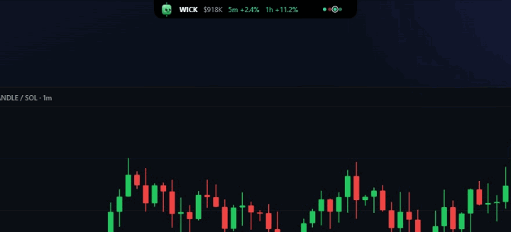

**[Install Candy](#install)** · [Meet Candy](#meet-candy) · [Features](#features) · [Safety](#safety) · [Privacy](#privacy)

</div>

---

## Why

Trading memecoins means ten tabs open and none of them where you are looking. Candy keeps the one thing you need, what your tokens are doing right now, in a thin ticker at the top of your screen, and calls you when it is time to look.

It reads public market data only. It never asks for a seed phrase or a private key, never trades, and there is no account. Free and open source: you build it on your own computer from this code, so what runs is exactly what you can read here.

## Meet Candy

Candy is a candle with a face. It wears your colour, turns red on a loss, and feels the market with you.

<table>
  <tr>
    <td width="50%">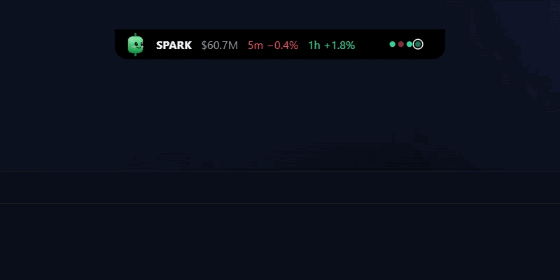<br><b>Hello</b>: it drops into the island every time it starts.</td>
    <td width="50%">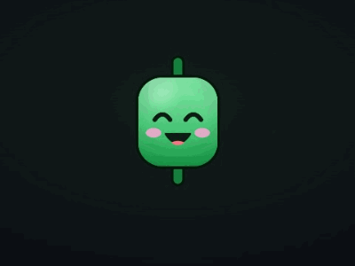<br><b>Moods</b> that follow your watchlist and the market.</td>
  </tr>
  <tr>
    <td><br><b>Drop a token link</b> on it: it swallows it onto the watchlist.</td>
    <td>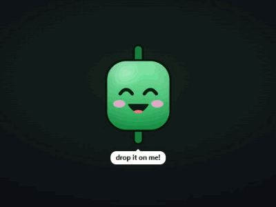<br><b>Pokes</b>, and what too many of them do.</td>
  </tr>
  <tr>
    <td><br><b>Wardrobe</b>: 36 hats, 35 faces, 23 colours, and the loose bits swing.</td>
    <td>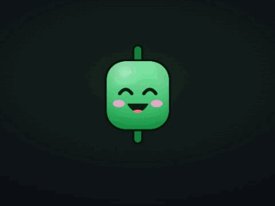<br><b>Little extras</b>, now and then, never every time.</td>
  </tr>
  <tr>
    <td>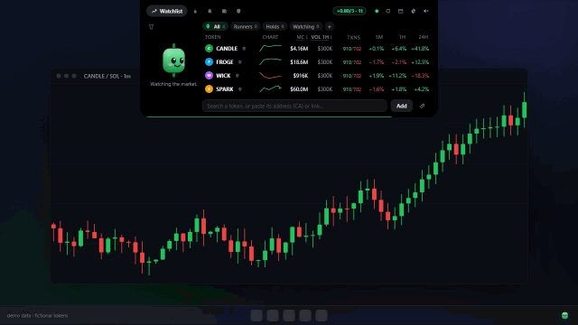<br><b>Anywhere</b>: the top, a side, or floating where you drag it.</td>
    <td>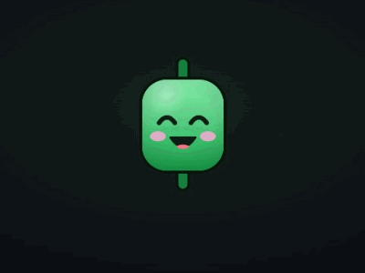<br><b>Dances</b> to whatever plays (Windows, Linux).</td>
  </tr>
</table>

Drag Candy out of the ticker and it sits on your desktop, next to your chart, until you double-click it home.

## Features

- 📈 **Watchlist ticker**: market cap (the price, for major coins), volume, buys and sells, and the 5m, 1h and 24h moves, always in view. Folders (Runners, Holds, Watching, your own), pins, sorting by any column, and a mini 24 h chart with its chain's coin as a dashed line: did it rise alone or with the market? Folded, a dot per token shows the last hour, and the ticker calls out each buy and sell, yours and the wallets you follow, as it happens.
- 🔔 **Alerts**: price or market cap above or below a level, % moves within 5 to 60 minutes, liquidity pulled, volume surges, a token leaving pump.fun's curve, market cap milestones ($1M, $5M, $10M…) and sells running far ahead of buys. Candy reacts, a sound plays (one per folder if you like), and a card opens: open the token, set a 2x alert, or mute it for an hour.
- 🧲 **Drag and drop**: a DexScreener, GMGN, Axiom, Based Bot or explorer link, or a bare address, dropped on Candy joins the watchlist. Or copy it and press Ctrl + Alt + V.
- 👛 **My wallet** (public address only; a Solana address, or a 0x address followed on Ethereum, BSC and Base at once): value, average entry, PnL, % and multiple per token, worked out from its own transactions, with the way to your target, stop or next multiple, and alerts at 2x, −30% or wherever you set them. Airdropped scams and unsellable coins are left out.
- 🔎 **Search that knows the real coin**: type "btc" and Bitcoin comes first with its rank, above the copycats that share the ticker. Fakes reporting made-up liquidity are flagged ⚠. The 30 largest coins are priced from CoinGecko.
- 🧪 **Before an entry**: Candy goes over a checklist with you, one line at a time: mint and freeze authority, locked liquidity, top holders, age and real liquidity, with what RugCheck and DexScreener say. A RugCheck badge on every token, and a note per token for why you are in and the exit plan.
- 📅 **Economic calendar**: a heads-up before the US releases the whole market moves on (CPI, the Fed, the jobs report, PCE), and the next one in the header.
- 🧘 **Discipline**: a daily loss limit, a trade cap, a cooldown after a loss, a tilt break, break reminders, a session end, a size calculator, and a check-in after each trade. Or turn it all off.
- 📓 **Journal**: weekly stats, 16 weeks of green and red days, notes, CSV export.
- 🖼️ **Share my day, my week, my month**: a recap image with Candy for X or Telegram, amounts optional.
- 🧭 **Trending** (DexScreener's boosted and newest tokens) and 👀 **Following** (an alert when a wallet you follow buys or sells).
- 📍 **Anywhere**: floating (the default), the top edge, or the left or right edge as a slim tab that opens into a sidebar. On a MacBook with a notch the top island grows out of the notch.
- ⌨️ **Shortcuts** from any app: show and hide, add the copied token, open the waiting alert, switch tabs, mute, the wardrobe, Candy to the desktop.
- 🎨 **Make it yours**: 18 island looks, five of them full themes that restyle every word, card and highlight (Terminal, Vaporwave, Matrix, Paper, Blueprint), as see-through as you like, costumes that redraw the whole mascot, seasonal looks, your own sounds.
- 🌍 **Ten languages**: English, Português, Español, Français, Deutsch, Русский, Türkçe, 简体中文, 日本語 and 한국어, your system's by default and switched live.
- 🔒 **Private by design**: no account, no telemetry, only public market data. See [Privacy](#privacy).

<table>
  <tr>
    <td width="50%">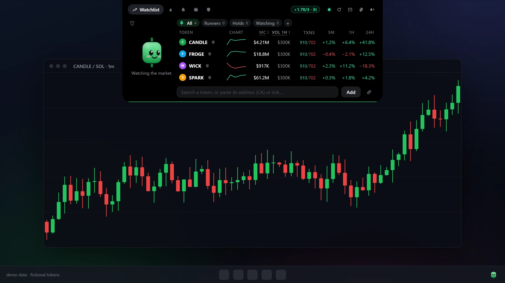<br><b>The watchlist</b>, open.</td>
    <td width="50%">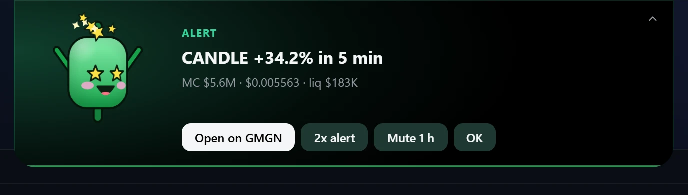<br><b>Alerts</b>: the moment something moves.</td>
  </tr>
  <tr>
    <td>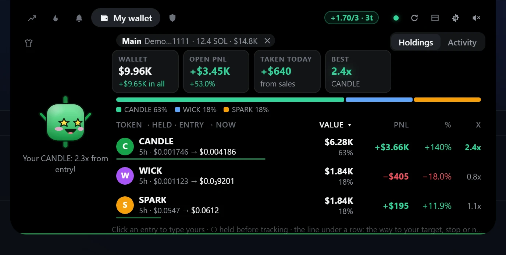<br><b>My wallet</b>: entries, PnL and multiples.</td>
    <td>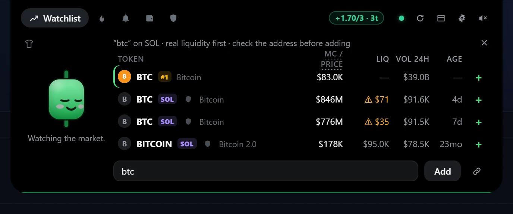<br><b>Search</b>: the real coin first, fakes flagged ⚠.</td>
  </tr>
  <tr>
    <td>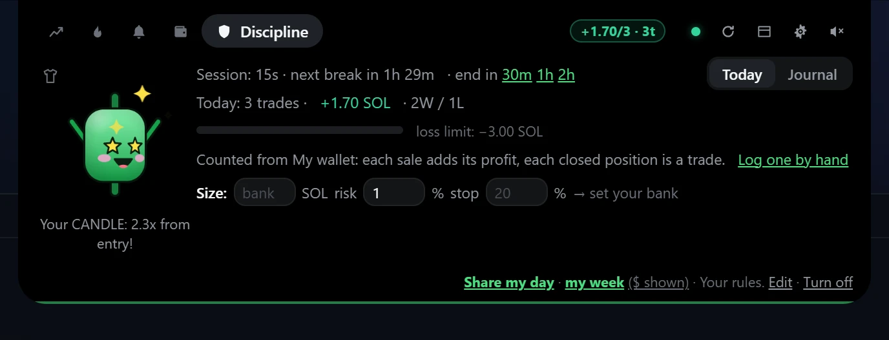<br><b>Discipline</b>: your own rules, kept for you.</td>
    <td>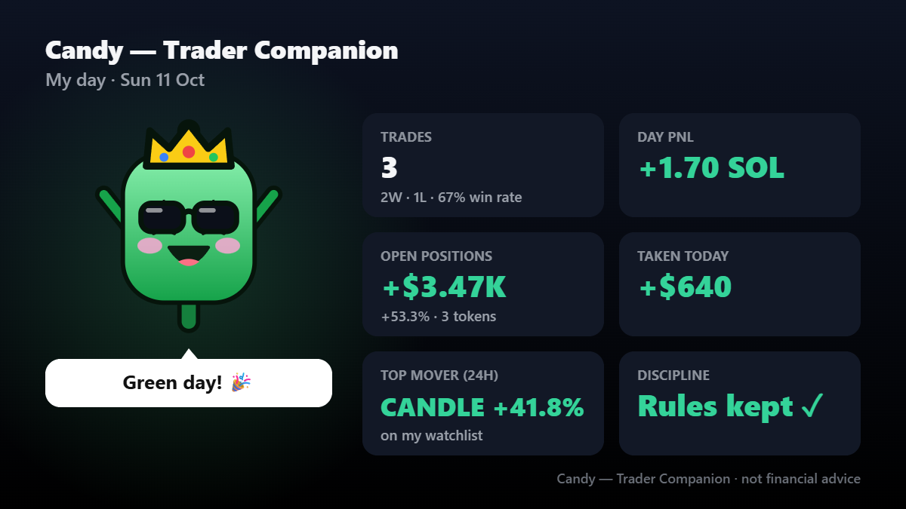<br><b>Share my day</b>: a recap image for X or Telegram.</td>
  </tr>
</table>

<sub>Every number in these pictures and animations comes from the demo's made-up tokens.</sub>

## Things to try

| Do this | Candy does that |
| --- | --- |
| Click the ticker (or just rest the mouse on it, with Open on hover in Settings) | the island opens |
| Rest the mouse on a token's row | its candles open, 1 m to 24 h |
| Drag a token link onto Candy | opens wide and swallows it |
| Keep clicking Candy | waves, spins, gets dizzy at five, fed up at eight |
| Rest the mouse on Candy | holds up a sign with today's PnL |
| Right-click Candy | a menu: dance, wave, laugh, spin, or the wardrobe |
| Click the gear (or the tray's Settings… or Closet…) | the island itself grows into Settings or the Closet, no window of its own; ×, Esc or the gear again and it goes back exactly as it was |
| Hold a token that doubles | puts on his shades for a few seconds |
| Drag Candy out of the ticker | sits on your desktop until you double-click it |
| Hold Ctrl (⌃ on a Mac) over the island *(Windows, macOS)* | fades and lets your clicks through to what is behind |
| Click a browser tab under the ticker at the top *(Windows, macOS)* | the click goes to the tab: the ticker only takes the mouse once the cursor rests on it |
| Copy an address, press Ctrl + Alt + V (⌘ ⌥ V) | adds the token |
| Tray icon → Try the demo | a 30-second tour with made-up coins, nothing saved |
| Run it on a laptop | the island comes compact by itself: lower, smaller type, fewer columns (Settings → General → Compact island) |

## Install

Candy is open source, and the installers on its [Releases page](https://github.com/0xVendet4/trader-companion/releases/latest) are built from this code by GitHub itself, in public (every build is on the [Actions](https://github.com/0xVendet4/trader-companion/actions) page): what you run is what you can read here, and each release lists the SHA256 of its files next to the build that made them. Rather compile it on your own computer? Each system has that way too, below.

### Windows

Download **`Candy-Windows-<version>-setup.exe`** from the [latest release](https://github.com/0xVendet4/trader-companion/releases/latest) and double-click it. Windows asks once, because the installer isn't signed with a paid certificate: click *More info → Run anyway*. It installs Candy for your user, with no wizard to click through, and starts it; Candy lands in your Start menu, and *Installed apps* removes it.

<details>
<summary><b>Or build it yourself</b></summary>

Get the code: **Code → Download ZIP** at the top of this page, then unzip it (or `git clone` it).

**The simple way:** double-click **`Install Candy.cmd`** in the unzipped folder (opened from inside the ZIP, it finds nothing to build).

Windows warns that the file came from the internet: click *More info → Run anyway* (or *Run*). It is a short text file; right-click → *Edit* shows all it does. It asks before installing the tools a build needs (Node.js, Rust and Microsoft's C++ build tools, with winget, Windows' own app installer), builds Candy (some minutes the first time, about a minute after), installs it and starts it: there is no installer to click through. Its window shows three steps and closes by itself. If something goes wrong, it says what, and the details are in `%LOCALAPPDATA%\Candy-build\install.log`.

**Or type it yourself:**

1. **The tools, once.** In a terminal (search "Terminal" in the Start menu):

   ```
   winget install -e --id OpenJS.NodeJS.LTS
   winget install -e --id Rustlang.Rustup
   winget install -e --id Microsoft.VisualStudio.2022.BuildTools --override "--quiet --wait --norestart --add Microsoft.VisualStudio.Workload.VCTools --includeRecommended"
   ```

   Node.js, Rust, and Microsoft's C++ build tools (a few GB; Windows asks for permission). Skip any you already have.

2. **Build and install.** Open a new terminal in the Candy folder (in Explorer, right-click the folder → *Open in Terminal*) and run:

   ```
   npm ci
   npm run setup
   ```

   It builds Candy, 10–20 minutes the first time, installs it and starts it; Candy lands in your Start menu. If PowerShell says running scripts is disabled, type `npm.cmd` instead of `npm`.

</details>

### macOS

Download **`Candy-macOS-<version>.zip`** from the [latest release](https://github.com/0xVendet4/trader-companion/releases/latest), double-click it to unzip, and drag **`Candy.app`** to your Applications folder. The first time you open it, macOS says it can't check the app, because it isn't signed with an Apple developer certificate: open *System Settings → Privacy & Security*, scroll down and click *Open Anyway* (on macOS 14 or older: right-click Candy → *Open* → *Open*). Candy lives in the menu bar, with no Dock icon; one app runs on Apple Silicon and Intel Macs, macOS 11 or newer. To remove it, drag `Candy.app` to the Trash.

<details>
<summary><b>Or build it yourself</b></summary>

Get the code: **Code → Download ZIP** at the top of this page (Safari unzips the download by itself; otherwise double-click the ZIP), or `git clone` it.

**The simple way:** double-click **`Install Candy.command`** in the unzipped folder.

macOS says it can't check the file, because it came from the internet: open *System Settings → Privacy & Security*, scroll down and click *Open Anyway* (on macOS 14 or older: right-click the file → *Open* → *Open*). It is a short text file; TextEdit shows all it does. It asks before installing the tools a build needs (Apple's Command Line Tools, Rust and Node.js, each from its own official source; Apple's tools and Node.js ask for your Mac's password), builds Candy (10–20 minutes the first time, a few after), puts `Candy.app` in your own `~/Applications` and starts it. It lives in the menu bar, with no Dock icon. If macOS asks whether Terminal may use your Downloads folder, click *OK*. If something goes wrong, it says what, and the details are in `~/Library/Caches/Candy/install.log`.

To remove a Candy built this way, double-click **`Uninstall Candy.command`** in the same folder: it removes the app, its settings and its build files, and asks before removing the tools too.

**Or type it yourself:**

1. **The tools, once.** In Terminal:

   ```bash
   xcode-select --install
   curl --proto '=https' --tlsv1.2 -sSf https://sh.rustup.rs | sh
   ```

   Apple's Command Line Tools, then Rust. And Node.js 20 or newer, from [nodejs.org](https://nodejs.org/) (or `brew install node`).

2. **Build and install.** In the Candy folder:

   ```bash
   npm ci
   npm run setup
   ```

</details>

On a MacBook with a notch, the island at the top of the screen grows out of the notch, over the menu bar. On a Mac there is no music card or dance yet (no public way to know what plays), no buttons on notifications and no quiet mode for fullscreen apps. The shortcuts use ⌘ where Windows has Ctrl (⌘ ⌥ V adds the copied token), and holding ⌃ Control over the island clicks through it.

### Linux

Candy builds on your own computer on Linux, 10–20 minutes the first time.

1. **The tools, once.** The build libraries, from your distribution:

   ```bash
   # Debian, Ubuntu, Mint, Pop!_OS
   sudo apt install build-essential curl wget file pkg-config libssl-dev libwebkit2gtk-4.1-dev libxdo-dev libayatana-appindicator3-dev librsvg2-dev libgtk-layer-shell-dev
   # Fedora
   sudo dnf install gcc gcc-c++ make curl wget file pkgconf-pkg-config openssl-devel webkit2gtk4.1-devel libxdo-devel libappindicator-gtk3-devel librsvg2-devel gtk-layer-shell-devel
   # Arch, Manjaro
   sudo pacman -S --needed base-devel curl wget file openssl webkit2gtk-4.1 xdotool libappindicator-gtk3 librsvg gtk-layer-shell
   ```

   Rust, from [rustup.rs](https://rustup.rs):

   ```bash
   curl --proto '=https' --tlsv1.2 -sSf https://sh.rustup.rs | sh
   ```

   And Node.js 20 or newer, from your distribution if it has one that recent, or from [nodejs.org](https://nodejs.org/) (nvm works too).

2. **Build and install.** In the Candy folder:

   ```bash
   npm ci
   npm run setup
   ```

   It builds Candy, 10–20 minutes the first time, and installs it for your user only: `~/.local/bin/candy`, with an entry in your app menu.

Linux doesn't let an app read the cursor across the screen, so Candy follows the mouse over the island itself:

- On **KDE, COSMIC, Hyprland, Sway** and other compositors with layer-shell, the island is an overlay above everything. On **GNOME** it runs through XWayland, as an always-on-top window. Every placement works on both, and the floating island drags with the mouse.
- Its eyes follow the mouse over the island only, and there is no Ctrl pass-through.
- The shortcuts work where your desktop lets apps have global shortcuts (X11, and GNOME through XWayland).
- A blank island on some graphics drivers: start it with `WEBKIT_DISABLE_DMABUF_RENDERER=1 candy`.

What `npm run setup` does is in [`scripts/setup.mjs`](scripts/setup.mjs), a short file you can read before running it: it checks the tools, builds, and installs. What a build downloads is the libraries pinned in `package-lock.json` and `Cargo.lock`, and on Windows the NSIS installer maker Tauri uses.

### Updates

Candy checks GitHub for a newer release a minute after it starts and every half hour after, and asks before doing anything. **Update now** downloads the new version and installs it (on Windows the installer runs on its own; on a Mac the app is swapped for the new one), then starts Candy again; your settings stay. On Linux, and wherever a release has no file for your system, it downloads the new code instead and builds it in the background while you keep using Candy, a few minutes (what it compiled before is reused). By hand, anywhere: download the new installer, or get the new code and run the installer again. Which version you have: hover Candy's tray icon, or look next to the title of its Settings.

What a build compiled is kept in `%LOCALAPPDATA%\Candy-build` (Linux: `~/.cache/candy/build`, macOS: `~/Library/Caches/Candy/build`); delete that folder to free a few GB.

## Using Candy

### Add the copied token

Copy a token's address (CA) or its DexScreener, GMGN, Axiom, Based Bot or explorer link anywhere, press **Ctrl + Alt + V**, and Candy swallows it onto the watchlist. Only a whole address or a whole token link counts: anything else on the clipboard is ignored and never sent anywhere. Settings → Watchlist → Pasted or dropped: open it too also opens it on your terminal.

### Shortcuts

They work from any app, and each can be changed or turned off in Settings → Notifications and shortcuts (click the keys, press new ones):

| Keys | What it does |
| --- | --- |
| Ctrl + Shift + Space | Show or hide the island |
| Ctrl + Alt + V | Add the copied token |
| Ctrl + Alt + A | Open the waiting alert (or the Alerts tab) |
| Ctrl + Alt + → / ← | Next / previous tab |
| Ctrl + Alt + S | Mute or unmute |
| Ctrl + Alt + G | Wardrobe |
| Ctrl + Alt + D | Candy to the desktop, or home |

On a Mac, ⌘ takes Ctrl's place. Ctrl + Alt is AltGr on many keyboards: the defaults avoid the keys that type a character with AltGr on the usual European and Brazilian layouts, and on Windows Candy asks what each Ctrl + Alt combination types on your layouts, so one that types something is left alone and flagged in Settings. While you type in the island, Ctrl + 1–9 picks a tab and Ctrl + , opens Settings.

### Candy on your desktop

Open the island and drag Candy out of it: it lands on your desktop, in its own little window, and stays there, next to your chart, looking at your mouse and reacting to the market. Click it to poke it, drag it to move it, double-click it (or drop it back on the island) to send it home. An alert card brings it back to the island to show it, and it flies out again once the card is dismissed. Left alone for two minutes with the mouse away, it dozes off, and then costs nothing. It remembers its spot between launches. On Linux this works on X11, on GNOME through XWayland and on compositors with layer-shell (KDE, Sway, Hyprland, COSMIC).

### Dance when music plays

Whatever plays on the computer (Spotify, a browser video, any player the system knows about), Candy bobs along while the island is on screen, unless its mood is in no state for it. Nothing is polled: the system says when playback changes. Settings → Appearance → Dance when music plays turns it off. Windows and Linux.

### Your own sounds

Put a recording named after one of Candy's sounds in `%APPDATA%\TraderCompanion\sounds` (Linux: `~/.config/candy/sounds`, macOS: `~/Library/Application Support/Candy/sounds`) and it plays instead of the built-in one. The names: `open`, `close`, `blip`, `hover`, `pop`, `alert-up`, `alert-down`, `warn`, `reminder`, `greet`, `boing`, `squeak`, `whee`, `eep`, `dizzy`, `grumble`, `achoo`, `tada`, `hmm`; as `.wav`, `.mp3`, `.ogg` or `.oga`, `.m4a` or `.aac`, `.flac`, `.aiff` or `.aif`, or `.caf`, up to 8 MB each. Settings → General → Your own sounds opens the folder and reloads it.

## Versions

A new version is a commit on `main` with the version bumped: GitHub builds it, publishes the [release](https://github.com/0xVendet4/trader-companion/releases), and a running Candy offers it within the hour.

| Version | Date | Highlights |
| --- | --- | --- |
| 0.1.16 | Oct 19, 2026 | Installers for Windows and macOS on the Releases page, built by GitHub; Update now installs them |
| 0.1.15 | Oct 14, 2026 | Island themes, a compact island, the hover chart, 0x wallets on Ethereum, BSC and Base, the Closet, night looks, emotes, Settings and the Closet inside the island, Update now on macOS and Linux |
| 0.1.14 | Oct 10, 2026 | Candy can be dragged out of the island |
| 0.1.13 | Oct 10, 2026 | 10 languages, economic calendar, swinging accessories, macOS, now-and-then effects, market cap milestones, sell pressure, pin and sort, monthly recap |
| 0.1.12 | Oct 10, 2026 | Candy drawn live, Candy on the desktop, music, shortcuts, the entry checklist, a new wallet tab, Discipline on or off, Based Bot |
| 0.1.11 | Oct 8, 2026 | Drag and drop, watchlist dots, the tray's mood, tinted alerts |
| 0.1.10 | Oct 8, 2026 | Checks for updates every half hour |
| 0.1.9 | Oct 8, 2026 | Tidier prices, up-to-date tooling |
| 0.1.8 | Oct 8, 2026 | Real logos for major coins, late logos for memecoins |
| 0.1.7 | Oct 8, 2026 | The version on the tray icon and in Settings |
| 0.1.6 | Oct 7, 2026 | Prices for major coins, README pictures, a new demo video |
| 0.1.5 | Oct 7, 2026 | Minimize hides a floating island too |
| 0.1.4 | Oct 7, 2026 | Major coins live: CoinGecko's top 30, tagged with their rank |
| 0.1.3 | Oct 7, 2026 | Install with no wizard; failures said in the window |
| 0.1.2 | Oct 7, 2026 | In-app updates, asked first |
| 0.1.1 | Oct 6, 2026 | Red on a loss, a minimize button, sharing |

## Safety

- Reads **public data only**: DexScreener, RugCheck, CoinGecko (for major coins), alternative.me's Fear & Greed index and Forex Factory's calendar (public, no key), and public RPCs for your wallet: Solana's (with two keyless spares for when it is busy), four read-only calls (balances, token accounts, and the transactions a position's entry comes from), whitelisted in Rust (`solana_rpc`); for a 0x wallet, Ethereum's, BSC's and Base's (PublicNode, with a spare each), four read-only calls too (the balance, a token's `balanceOf`, the latest block and a watched token's Transfer logs), whitelisted in Rust (`evm_rpc`). Sending a transaction is refused in code, and a test checks it.
- **Never** asks for, stores or touches a wallet, a seed phrase, a private key or an exchange account. It cannot trade.
- Tokens are added by **address or link**, never by a ticker alone: every popular memecoin has copycats with the same symbol, so a search shows the candidates with their real liquidity and you pick one.
- The paste shortcut reads the clipboard only when you press it, and a private key or a seed phrase there is refused, never kept or sent.
- Links open only on a fixed list of sites (`ALLOWED_HOSTS` in `src-tauri/src/lib.rs`), never from token metadata.
- Not financial advice. The app shows numbers and the alerts you set up.

## Privacy

Candy has no account, no analytics and no telemetry. It keeps everything on your computer: settings, watchlist, journal and wallet book in `%APPDATA%\TraderCompanion` (Linux: `~/.config/candy`, macOS: `~/Library/Application Support/Candy`; with a copy of the settings at most twice a day, `settings.daily.json`, to go back to), a log in `%LOCALAPPDATA%\TraderCompanion` (Linux: `~/.local/share/candy`, macOS: `~/Library/Logs/Candy`).

It talks only to public services, for public data:

- **DexScreener** (`api.dexscreener.com`, token images from `cdn.dexscreener.com` and `dd.dexscreener.com`): prices, market caps, volumes, search and trending. It is sent the token addresses on your watchlist and in your wallet.
- **RugCheck** (`api.rugcheck.xyz`): a token's safety report, for tokens you open.
- **alternative.me** (`api.alternative.me`): the crypto Fear & Greed index.
- **Forex Factory** (`nfs.faireconomy.media`): this week's economic calendar, every few hours while its heads-up is on. Nothing is sent but the request.
- **CoinGecko** (`api.coingecko.com`, logos from `coin-images.coingecko.com` and `assets.coingecko.com`): the largest coins (at most hourly, when you search), and a major coin's own market cap, 24 h volume, rank and logo, a few times an hour, only while one is on your watchlist or in a search. It is sent the names of those coins (bitcoin, dogecoin…).
- **GeckoTerminal** (`api.geckoterminal.com`): a token's candles for the chart that opens when you rest the mouse on its row, only while that chart is open (one request per token and candle size, kept for a candle's length, at most five minutes). It is sent that token's pool address.
- **Solana's public RPC** (`api.mainnet-beta.solana.com`): the balances and transactions of the wallet addresses you add (public addresses only; read-only calls, spaced to stay under its limits). If you paste your own RPC URL in the settings (Helius, Alchemy, QuickNode…: a free key takes a minute), these calls go to it instead; the URL stays on your computer.
- **Spare public RPCs**, only when Solana's is busy and no RPC of your own is set: PublicNode (`solana-rpc.publicnode.com`) and Solana Vibe Station (`public.rpc.solanavibestation.com`), for the calls each one serves. They see the same thing: the wallet addresses asked about.
- **Public EVM RPCs**, for a 0x wallet you add (followed on Ethereum, BSC and Base at once): PublicNode (`ethereum-rpc.publicnode.com`, `bsc-rpc.publicnode.com`, `base-rpc.publicnode.com`), and when one is busy its spare, LlamaRPC (`eth.llamarpc.com`), Binance (`bsc-dataseed.binance.org`) or Base (`mainnet.base.org`). Read-only calls only: the wallet's balance, its balance of the tokens on your watchlist, and the recent transfers of those tokens; they see the wallet and token addresses asked about.

And GitHub, for updates: every half hour Candy reads the version in this repository (`raw.githubusercontent.com`), and only when you say *Update now* does it download the code (`codeload.github.com`).

Each of these services sees your IP address, as with any website. Links you click open in your browser (GMGN, Axiom, Based Bot, DexScreener, RugCheck, Solscan, Etherscan, BscScan, BaseScan, GitHub, and Helius or Alchemy for a free RPC key).

## How it works

- **The app**: [Tauri 2](https://tauri.app). Rust for the window, the tray, the settings file and the network calls; TypeScript with no framework for the island.
- **The island**: a borderless, transparent, always-on-top window that never takes the keyboard unless you type in it. On Windows and macOS it reads the cursor about 60 times a second while it is on screen, to know when you hover it, to let clicks through everywhere else and to drag it; hidden, it shrinks to a thin edge that lets clicks through too (a browser tab under it stays clickable) and comes back when the cursor rests there, checked 20 times a second. On Linux it is a layer-shell overlay (KDE, Sway, Hyprland, COSMIC) or an X11 window (GNOME), and the compositor sends it only the clicks on the island itself.
- **Candy**: drawn on a canvas every frame from its SVG art, with springs for the hops, the leans and the bits of a hat that swing, and particles for the hearts, confetti, coins and rain.
- **The market**: DexScreener and CoinGecko polled while you watch, a price history kept per token for the windowed alerts, and the mood worked out from all of it.

## Develop

Requirements: the tools in [Install](#install) (Node 22+ for the tests, Rust, and [Tauri's prerequisites](https://tauri.app/start/prerequisites/) plus gtk-layer-shell on Linux).

```bash
npm install
npm run tauri dev     # the real app
npm run dev           # the UI only, in a browser at http://localhost:1420
npm test              # unit tests (alerts, mood, discipline, formatting…)
npm run setup         # build and install (README → Install); --build-only to just build
npm run pack          # Windows: the installer → release/
npm run bump -- 0.1.2 # a new version, everywhere it is written; push it and installs offer the update
npm run i18n          # what each language is missing (src/i18n/); -- --keys lists every English line
```

Every visible line goes through `t("…")` (`src/core/i18n.ts`), with English as the key; `src/i18n/<language>.ts` holds the other nine, and a test fails when one of them misses a line the code uses.

In a browser the island runs on the same code, with settings kept in localStorage; Settings and the Closet open in the island there too (the gear), and `/demo.html` plays the scripted demo. With `npm run dev` running, `npm run panel-check` opens and closes them a few times and fails if anything of theirs keeps running afterwards (Candy uses no CPU while the island is hidden).

### The demo, the pictures and the GIFs

`/demo.html` plays a scripted tour of about a minute and a half with fictional tokens. With `npm run dev` running:

```bash
npm run record-demo   # the video → release/candy-demo.mp4 (1920×1080); -- vertical, -- --music song.mp3, -- --no-music
npm run screenshots   # this README's pictures → docs/images/
npm run gifs          # this README's animations → docs/media/ (-- moods pokes for just those)
```

They drive a headless Microsoft Edge; no ffmpeg needed. The music and the effects are synthesised in [`src/demo/soundtrack.ts`](src/demo/soundtrack.ts): nothing to license.

### Layout

| Path | What |
| --- | --- |
| `src/companion.ts` | Polling, price history, alerts, discipline clock, mood, saving |
| `src/market/` | DexScreener, CoinGecko and RugCheck clients, major coins, the calendar, trading-terminal links |
| `src/alerts/`, `src/mood/`, `src/discipline/` | Pure logic, unit-tested |
| `src/mascot/` | Candy: the canvas engine, the pieces that swing, the particles, the art in `public/mascot/` |
| `src/island/`, `src/views/` | The island window and its views |
| `src/desktop/` | Candy's desktop window |
| `src/settings/`, `src/closet/` | Settings and the Closet, the pages that open in the island (`src/core/panel.ts` places the panel) |
| `src/i18n/` | The nine other languages (English is in the code) |
| `src/demo/` | The scripted demo, its clips and stills |
| `src-tauri/` | Window placement, click-through, tray, settings file, links, one file per OS in `platform/` |
| `scripts/` | Install, build, version bump, the demo video, the README's pictures and GIFs |

<div align="center">

**If Candy saved you from one bad trade, a ⭐ helps a lot.**

</div>
